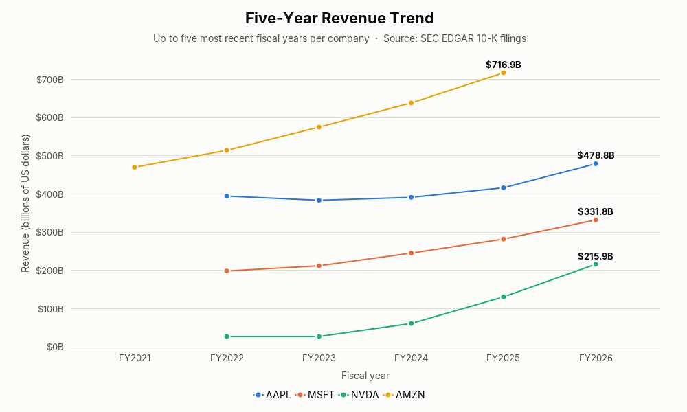
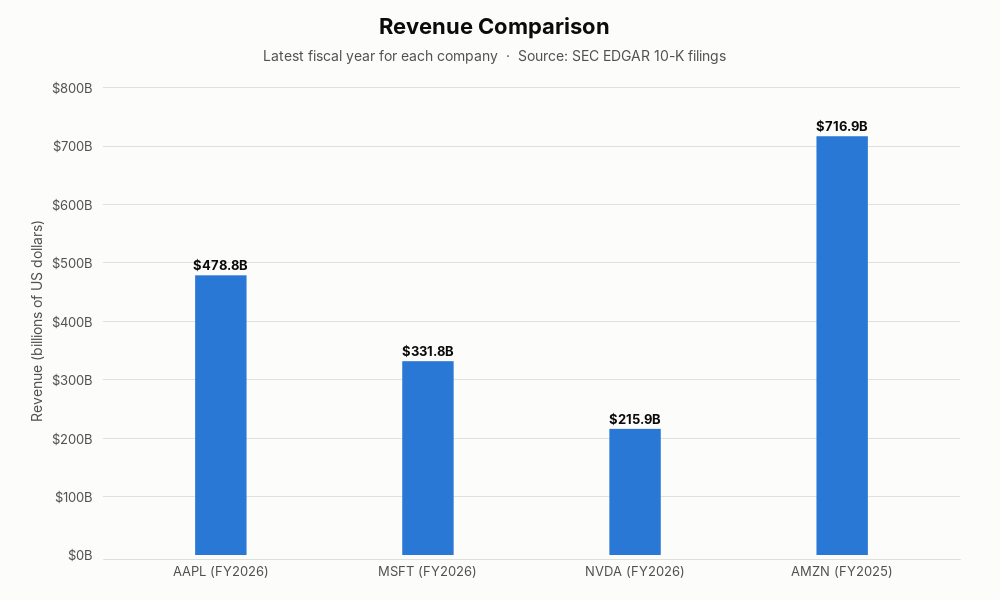
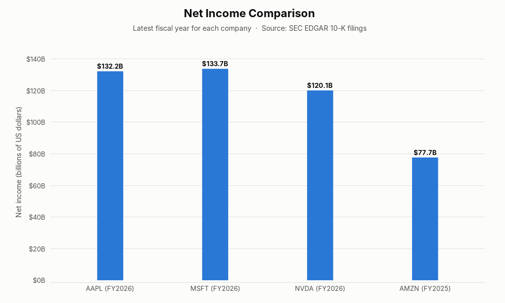
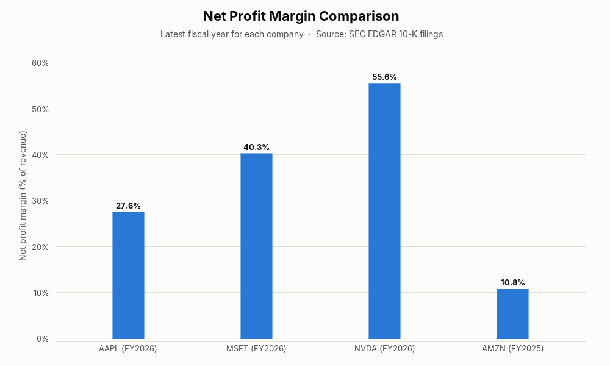

# StockScope

**Compare public companies side by side using real financial statement data from the SEC.**

StockScope is a Java console application. You enter 2–4 stock tickers; it downloads each company's
annual financial statements from the SEC's free EDGAR API, cleans the data, calculates key financial
ratios, and shows a side-by-side comparison — with charts and a CSV export.

> **Educational project — not investment advice.** See the [disclaimer](#disclaimer).



## The problem

Comparing companies' fundamentals usually means digging through several 100-page annual reports
(10-K filings) and copying numbers by hand, or paying for a data service. Yet the data is already
public: every US public company files its financial statements with the SEC in a machine-readable
format called XBRL.

The catch is that the raw data is messy. The same number appears in several filings, annual reports
also contain quarterly figures, and companies use different names for the same line item. StockScope
turns that raw data into a clean, consistent comparison in a few seconds.

## Features

- **Ticker lookup** — type `AAPL`, `brk.b`, or `GOOGL`; StockScope finds the company's SEC identifier (CIK).
- **Five years of annual data** — revenue, net income, operating income, total assets, total liabilities,
  stockholders' equity, and cash, taken from 10-K filings.
- **Four calculated ratios** — net profit margin, operating margin, return on assets, and debt-to-equity.
  Reported values and calculated ratios are always shown separately.
- **Comparison of 2–4 companies**, identifying the highest revenue, net income, and net profit margin, and
  the lowest debt-to-equity, plus a plain-English explanation of every metric.
- **Four charts** saved as PNG files (three bar charts and a five-year trend line).
- **CSV export** of five years of data per company, ready for Excel or Google Sheets.
- **Clear error handling** — invalid tickers, companies without SEC data, network failures, and missing
  metrics all produce readable messages instead of crashes. Missing values show as `N/A`, never as a
  misleading `0`.
- **Local caching** — downloaded data is reused for 24 hours, so repeat lookups are instant.

## Technologies

| Purpose | Technology |
|---|---|
| Language | Java 17 (records, switch expressions, text blocks, `java.time`) |
| Build | Maven |
| HTTP requests | Java's built-in `HttpClient` |
| JSON parsing | Jackson |
| Charts | JFreeChart |
| Testing | JUnit (Jupiter) |
| Data source | SEC EDGAR Company Facts API — free, no API key |

## How the SEC data works

1. **Ticker → CIK.** The SEC publishes a list of about 10,000 tickers at
   `https://www.sec.gov/files/company_tickers.json`. Apple (`AAPL`) is CIK `320193`, which the API
   needs padded to 10 digits: `0000320193`.
2. **Company facts.** `https://data.sec.gov/api/xbrl/companyfacts/CIK0000320193.json` returns every
   number the company has reported, organized by accounting tag (`Revenues`, `NetIncomeLoss`, `Assets`, ...).
   Apple's file is about 4 MB.
3. **Cleaning.** The raw values need four fixes before they can be compared:

| Problem in the raw data | How StockScope handles it |
|---|---|
| Each value appears in several filings (a 10-K repeats the two prior years), and the `fy` field describes the *filing*, not the period. Apple's FY2023 revenue is labeled `fy: 2023`, `2024`, and `2025`. | Group values by their own period end date, and keep the most recently filed one (which also picks up restatements). |
| Annual reports also contain quarterly figures — Apple's 10-Ks include over 100 of them. | Keep only 10-K / 10-K/A values whose period lasts 350–380 days. |
| Companies use different tags for the same item, and switch over time (NVIDIA moved from `RevenueFromContractWithCustomer…` to `Revenues` in 2022). | Try a priority list of tags, year by year. |
| Some companies (Amazon, Walmart, Coca-Cola) never report a total liabilities figure. | Calculate it as Total Assets − Total Equity, marked with `*` on screen and `Yes` in the CSV. |

**Fair access.** The SEC asks every application to send a User-Agent header with a contact email, and
allows at most 10 requests per second. StockScope identifies itself as
`StockScope/1.0 (educational project) <your email>`, waits at least 200 ms between requests, and caches
every response for 24 hours.

### The ratios

| Ratio | Formula | Shown as N/A when |
|---|---|---|
| Net profit margin | Net income ÷ Revenue × 100 | revenue is missing or zero |
| Operating margin | Operating income ÷ Revenue × 100 | operating income isn't reported (common for banks) or revenue is zero |
| Return on assets | Net income ÷ Average total assets × 100, where average = (start of year + end of year) ÷ 2 | the previous year's assets aren't available |
| Debt-to-equity | Total liabilities ÷ Stockholders' equity | equity is zero or negative — a negative ratio would look misleadingly "low" |

## Installation

**Requirements:** Java 17 or newer (`java -version`), Maven 3.9 or newer (`mvn -version`), and an
internet connection the first time each company is looked up.

```bash
git clone https://github.com/ritvik-pratapa/Stock-Comparison.git
cd Stock-Comparison
mvn compile
```

**Set your contact email** (recommended). The SEC asks every application to identify itself. The
email is read from an environment variable, so it stays on your computer and never goes into the code:

```bash
# macOS / Linux
export STOCKSCOPE_CONTACT_EMAIL="you@example.com"
```

```powershell
# Windows PowerShell
$env:STOCKSCOPE_CONTACT_EMAIL="you@example.com"
```

## Running the application

```bash
mvn -q compile exec:java
```

Include `compile`: `exec:java` runs whatever was compiled last, so without it, code changes won't show up.

Run the tests:

```bash
mvn test
```

## Example usage

Real output from November 2026 (numbers change as companies file new reports):

```text
========================================
               STOCKSCOPE
       Financial Comparison Tool
========================================

Compare 2 to 4 companies by ticker symbol (e.g. AAPL, MSFT, NVDA). Type 'quit' to cancel.
Enter the first company ticker: AAPL
  Fetching financial information for AAPL...
  Loaded Apple Inc. (latest fiscal year: FY2026)
Enter the second company ticker: MSFT
  Fetching financial information for MSFT...
  Loaded MICROSOFT CORP (latest fiscal year: FY2026)
Enter the third company ticker (or press Enter to compare now): NVDA
  Fetching financial information for NVDA...
  Loaded NVIDIA CORP (latest fiscal year: FY2026)
Enter the fourth company ticker (or press Enter to compare now):

Successfully retrieved financial information.

========== COMPANY COMPARISON ==========
  Metric                          AAPL          MSFT          NVDA
  Latest Fiscal Year            FY2026        FY2026        FY2026
  Period Ended              2026-09-26    2026-06-30    2026-01-25
  --- Reported in 10-K filings ---
  Revenue                      $478.8B       $331.8B       $215.9B
  Net Income                   $132.2B       $133.7B       $120.1B
  Operating Income             $158.1B       $155.2B       $130.4B
  Total Assets                 $404.5B       $758.4B       $206.8B
  Total Liabilities            $292.5B       $316.0B        $49.5B
  --- Calculated by StockScope ---
  Net Profit Margin              27.6%         40.3%         55.6%
  Operating Margin               33.0%         46.8%         60.4%
  Return on Assets               34.6%         19.4%         75.4%
  Debt-to-Equity                  2.61          0.71          0.31

KEY FINDINGS (latest fiscal year)
  Highest revenue:            AAPL ($478.8B)
  Highest net income:         MSFT ($133.7B)
  Highest net profit margin:  NVDA (55.6%)
  Lowest debt-to-equity:      NVDA (0.31)

1. View detailed company information
2. View financial charts
3. Export comparison to CSV
4. Compare different companies
5. Exit
Select an option:
```

The full output also includes a guide to what each metric means. Option 1 shows five years of data for
one company. Options 2 and 3 save files to the `output/` folder, named after the tickers:

```text
output/AAPL-MSFT-NVDA_revenue.png
output/AAPL-MSFT-NVDA_net_income.png
output/AAPL-MSFT-NVDA_net_profit_margin.png
output/AAPL-MSFT-NVDA_revenue_trend.png
output/AAPL-MSFT-NVDA_comparison.csv
```

## Sample charts

Generated by StockScope for Apple, Microsoft, NVIDIA, and Amazon. Each bar is labeled with the
company's fiscal year, because fiscal years end in different months.

| | |
|---|---|
|  |  |
|  |  |

## Project structure

```text
src/main/java/com/stockscope/
├── Main.java                        Console menu and input validation
├── api/
│   ├── SecApiClient.java            HTTP requests, User-Agent, rate limiting, 24-hour cache
│   ├── CompanyLookup.java           Ticker → CIK lookup
│   └── SecApiException.java         Errors with user-friendly messages
├── models/
│   ├── Company.java                 Ticker, CIK, and name
│   ├── FinancialData.java           One fiscal year of reported values
│   ├── FinancialRatios.java         Calculated ratios (kept separate from reported values)
│   └── CompanyFinancials.java       A company and its yearly data
├── services/
│   ├── FinancialDataService.java    Cleans SEC JSON into one row per fiscal year
│   ├── FinancialRatioService.java   Ratio formulas with missing-data handling
│   └── ComparisonService.java       Highest / lowest across companies
├── charts/ChartGenerator.java       PNG charts with JFreeChart
├── export/CsvExporter.java          CSV export
├── ui/ReportPrinter.java            Console tables and reports
└── utils/FinancialFormatter.java    Formats $478.8B, 27.6%, N/A

src/test/java/com/stockscope/        76 JUnit tests (no network needed)
docs/images/                         Sample charts for this README
```

## Testing

The 76 JUnit tests run without internet access — they use small hand-written samples in the SEC's JSON
format and temporary folders. They cover:

- every ratio formula, including missing data, division by zero, losses, and negative equity
- the SEC data cleaning rules: duplicate filings, quarterly figures in annual reports, tag fallbacks,
  amended reports, and malformed entries
- comparison logic, including missing values, ties, and all-loss companies
- chart data preparation and PNG output, CSV content and escaping, and number formatting in other locales

Line coverage is 75% overall and 91% excluding `Main` (the interactive menu, which is tested by running
the app). To generate the coverage report yourself, run the command below and open
`target/site/jacoco/index.html`:

```bash
mvn org.jacoco:jacoco-maven-plugin:0.8.16:prepare-agent test org.jacoco:jacoco-maven-plugin:0.8.16:report
```

## Known limitations

- **US 10-K filers only.** Foreign companies that file 20-F or 40-F reports, and most ADRs, aren't supported.
- **Tag coverage.** Revenue is read from a fixed list of common tags. Some lenders and REITs use other
  tags, so their revenue shows as N/A. For some small banks, the fallback tag covers only fee income, so
  revenue in years before the bank started reporting a total can be understated.
- **Banks and insurers** usually don't report operating income (N/A), have naturally high debt-to-equity
  (customer deposits are liabilities), and define cash differently. Compare them with care against
  non-financial companies.
- **Fiscal years differ.** "Latest fiscal year" can mean September for Apple and December for Amazon.
  The comparison shows each company's period end date.
- **Calculated liabilities** (Total Assets − Total Equity) include any "temporary equity" a company reports
  between liabilities and equity.
- **Ticker changes.** When a company reorganizes, its ticker can point to a new SEC entity that has no
  10-K history yet (seen with `XOM` in November 2026).
- **Reported figures only** — no stock prices, so no valuation ratios like P/E. Cached data refreshes after
  24 hours; delete the `cache/` folder to refresh sooner.

## Future improvements

- Valuation metrics (P/E, price-to-sales) using a free stock price source
- Quarterly (10-Q) data and trailing-twelve-month figures
- More ratios: return on equity, current ratio, revenue growth
- Support for 20-F filers (IFRS taxonomy)
- Industry-aware comparisons that flag banks and insurers
- A runnable JAR so Maven isn't needed to run the app
- A graphical interface (JavaFX) or web front end

## How this project was built

StockScope was built by Ritvik Pratapa with Claude, Anthropic's AI assistant, as a coding partner —
roughly a 60/40 split.

- **Ritvik** came up with the project and wrote its full specification — the features, financial metrics,
  architecture, testing requirements, and nine-phase development plan — then directed the work phase by
  phase and reviewed it before publishing.
- **Claude** wrote much of the implementation with explanations, investigated the SEC data format,
  debugged problems found during testing, and drafted the tests and documentation.

## Disclaimer

StockScope is an educational project built to practice Java and financial analysis. It summarizes past
financial results reported to the SEC and **does not provide investment recommendations**. The key
findings describe which company had the highest or lowest value of a metric — not which company is the
better investment, which depends on many factors these numbers don't capture (valuation, growth, risk,
and industry). Data may contain errors from the source filings or from processing; check important
figures against the original filings on [SEC EDGAR](https://www.sec.gov/edgar/search/).
